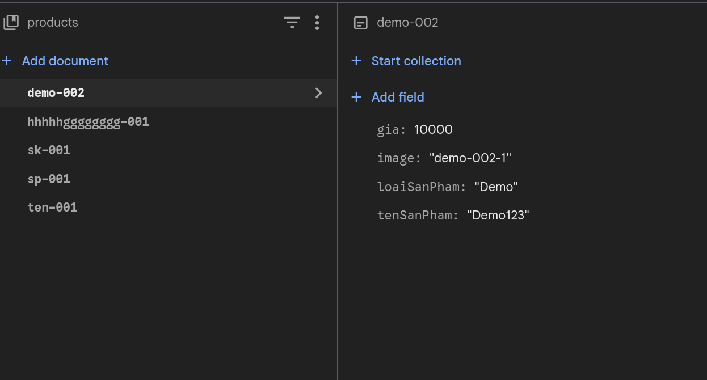

# ECOMER · Hệ thống nhập liệu sản phẩm

Ứng dụng Android quản lý dữ liệu sản phẩm: đăng nhập, thêm – sửa – xoá sản phẩm kèm ảnh, phân quyền người dùng và quản trị viên. Dữ liệu lưu trên **Firebase Cloud Firestore**.


## Tính năng

- **Đăng nhập / đăng xuất** bằng email + mật khẩu; đổi tài khoản ngay trong app.
- **Thêm sản phẩm**: tên, loại, giá và nhiều ảnh chọn từ thư viện (ảnh đầu tiên là ảnh đại diện).
- **Danh sách sản phẩm**: ảnh + tên + giá + loại; sửa bằng bút chì, xoá bằng thùng rác (có hộp thoại xác nhận).
- **Phân quyền** kiểm tra ở server bằng Firestore Security Rules.

## Ảnh review

Ảnh được trích từ video demo, cắt đúng phần màn hình ứng dụng và nén còn **dưới 1 MP mỗi ảnh** (giới hạn tải ảnh lên GitHub là 20 MP).

| Đăng nhập | Danh sách & thêm sản phẩm | Sửa sản phẩm | Xác nhận xoá |
|---|---|---|---|
|  |  |  |  |

### Dữ liệu trên Firestore



Document sản phẩm trong Firestore chỉ gồm đúng 4 trường: `tenSanPham`, `loaiSanPham`, `gia`, `image`.

## Phân quyền

| Vai trò | Xem sản phẩm | Thêm | Sửa / xoá |
|---|---|---|---|
| Khách (user) | Tất cả | ✅ | Chỉ sản phẩm do mình nhập |
| Admin | Tất cả | ✅ | Tất cả sản phẩm |

Admin xác định bằng email trong `User.ADMIN_EMAILS` và hàm `isAdmin()` của `firestore.rules`.

## Công nghệ

| Thành phần | Sử dụng |
|---|---|
| Ngôn ngữ | Kotlin |
| Giao diện | Jetpack Compose, Material 3, Navigation Compose |
| Backend | Firebase Authentication, Cloud Firestore |
| Ảnh | Base64 (resize ≤ 1080 px, nén < 700 KB), hiển thị qua Coil |

## Cài đặt

```bash
git clone https://github.com/nguyenkieuthinh/ecomer-vku-app.git
cd ecomer-vku-app
```

1. Tạo project Firebase, bật **Authentication → Email/Password** và **Firestore Database**.
2. Tải `google-services.json` của project, đặt vào `app/`.
3. Deploy Security Rules:

```bash
firebase deploy --only firestore:rules
```

4. Build và chạy:

```bash
./gradlew :app:installDebug
```

## Cơ sở dữ liệu

| Collection | Nội dung |
|---|---|
| `products` | Sản phẩm — đúng 4 trường: `tenSanPham`, `loaiSanPham`, `gia`, `image` |
| `product_images` | Mỗi ảnh một document: `productId`, `tieuDe`, `data` (base64), `tenFile`, `order` |
| `product_owners` | Chủ sở hữu sản phẩm: `userId`, `userEmail` |
| `users` | Hồ sơ người dùng và vai trò |
| `counters` | Bộ đếm sinh id sản phẩm (`ao-nam-001`, `ao-nam-002`…) |

Ảnh và chủ sở hữu được tách khỏi `products` để giữ đúng 4 trường và tránh giới hạn 1 MiB mỗi document của Firestore. Chi tiết: [`docs/CSDL.md`](docs/CSDL.md).

## Cấu trúc

```
app/src/main/java/com/ecomer/vku/app/
├── data/          model, repository, Firebase, xử lý ảnh
└── ui/            theme, components, navigation, screens
                   └── auth/     đăng nhập, đăng ký
                   └── products/ dữ liệu sản phẩm
```

## Tác giả

**nguyenkieuthinh** · [github.com/nguyenkieuthinh](https://github.com/nguyenkieuthinh)
